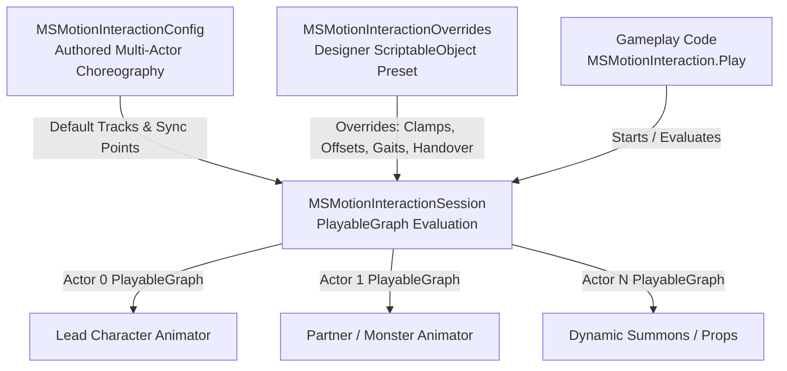

# Interaction Overrides System (`MSMotionInteractionOverrides`)

The **MSMotion Interaction Overrides System** provides a non-destructive, designer-friendly preset workflow for multi-actor choreographies. It allows technical animators, game designers, and programmers to adapt baked interaction sequences post-export—compensating for character body dimensions, swapping reaction clips, retargeting weapon variants, fine-tuning pre-interaction locomotion & motion warping, and redirecting prop handovers—**with zero re-exporting and zero code modifications**.

---

## Key Capabilities & Highlights

*   **Non-Destructive Post-Export Customization**: Modify character spacing, playback speed, locomotion clips, and summons without touching the authored `MSMotionInteractionConfig` asset.
*   **Granular Field-Level Toggles**: Every individual property features an independent 16px toggle checkbox. Only explicitly enabled properties override the baseline; unselected properties automatically inherit authored settings from the interaction track.
*   **Full Baseline Pre-Filling (FX Registry Paradigm)**: When adding an override or populating roles, all fields are immediately pre-populated with baseline authored values from the target interaction config. Designers can see exactly what the default is before deciding to tweak a specific property.
*   **4-Category Dynamic Alignment Foldouts**:
    1.  **🎬 Locomotion & Gaits**: Gait modes, walk/run clips, speed/distance thresholds, crossfade durations, and arrival downshifting.
    2.  **🧭 Pathfinding & Navigation**: Navigation modes, obstacle clearance radii, layer masks, corner smoothing, moving target tracking, and terrain raycasting.
    3.  **🔄 Steering & Arrival Rotation**: Angular turn speeds, arrival alignment radii, orientation matching, and pivot-in-place thresholds.
    4.  **⏱ Timing, Stride & Speed Bounds**: Natural stride velocity (**⚡ Auto Stride** root-motion extraction), arrival thresholds, duration bounds, playback speed bounds, acceleration curves, and custom velocity profiling.
*   **Collapsible Foldouts with Active Counter Badges**: Category headers collapse to keep the inspector organized, displaying real-time active override counts (e.g. `🎬 Locomotion & Gaits (4/8)`).
*   **Context Menus & Clipboard Tools**: Right-click category headers to **Enable All** or **Disable All** overrides in that section. Dedicated `[Copy]` and `[Paste]` buttons allow duplicating settings across roles with automatic section unfolding.
*   **Dynamic Summoned Actor & Prop Overrides**: Swap summoned weapon prefabs, bone attachment sockets, local offsets, 3D scale multipliers, and spawn/despawn timestamps.
*   **Direct FX Registry Overrides (Zero Asset Duplication)**: Directly override FX event themes (sounds, particles, decals, transforms) globally for the interaction or per-role without authoring extra `MSMotionAnimationConfig` assets.
*   **Cross-Actor FX & Prop Handover Rerouting**: Dynamically redirect weapon disarms, torches, or shared props to alternate teammates or target bones.
*   **Live Runtime PlayMode Tools**: Detects active scene interaction sessions in real time, displaying playback state and elapsed time with a 1-click **Apply Overrides to Active Session** button.
*   **1-Line C# Execution**: Play directly via `MSMotionInteraction.Play(config, overrides, actors...)` or apply dynamically to prepared sessions.

---

## Architecture & Data Flow

`MSMotionInteractionOverrides` is a ScriptableObject that sits between authored choreography assets and the active runtime session:



### Evaluation Hierarchy (Precedence Order)

When an interaction executes, values are resolved in the following strict order of precedence:

1.  **Runtime Fluent Overrides**: Programmatic session calls made before playback (e.g. `session.OverrideActorClip(...)`, `session.OverrideActorFXRegistry(...)`).
2.  **Interaction Overrides Preset (`MSMotionInteractionOverrides`)**: Properties explicitly enabled with their toggle checkbox set to `true`:
    *   **Role-Specific Overrides**: Role-level clip, config, offset, speed, and FX registry overrides take highest priority within the preset.
    *   **Interaction-Wide Overrides**: Global settings such as interaction-wide FX Registry and ground LayerMask apply to all roles not individually overridden.
3.  **Authored Baseline Configuration (`MSMotionInteractionConfig`)**: Default values authored in the Composition Editor timeline and Actor Roster window.

#### FX Registry Precedence Flow:
`Session Role Override` ➔ `Session Global Override` ➔ `Preset Role Override` ➔ `Preset Global Override` ➔ `Track Config Override` ➔ `Global Fallback Registry`

---

## Creating & Configuring Interaction Overrides

### 1. Asset Creation
1. In the Unity Project window, right-click in your desired folder.
2. Select **Create > Maharaja Studio > MsMotion > Interaction Overrides**.
3. Name the asset (e.g. `OgreTakedown_Overrides` or `SalsaDuet_TallPartner`).

### 2. Inspector Overview

The custom inspector provides an intuitive, high-density control deck:

```
+-----------------------------------------------------------------------------------+
| MSMotion Interaction Overrides (HelpBox Banner)                                   |
| Target Interaction Config: [ S_Duet_Exported_Config                     (⊙) ]     |
+-----------------------------------------------------------------------------------+
| Detected Roles in Config                                                          |
| Participants: 2 | Dynamic Entities: 1 | Handovers: 2 | Duration: 4.37s | Loop: False |
| [ [Participant] partner (Actor_1) ▼ ]  [ Add Override ]                           |
| [               Populate All               ]  [             Sync from Config             ] |
+-----------------------------------------------------------------------------------+
| ▼ Participant Role Overrides (2)                                                  |
|   +-----------------------------------------------------------------------------+ |
|   | ▼ Participant Role: 'partner' (4 active overrides)        [🔄] [📄] [📋]   | |
|   |   Role Identifier: [ partner              ]               [📄] [📋]         | |
|   |   [✓] Animation Config: [ Partner_Variant_Config              (⊙) ]         | |
|   |   [ ] Animation Clip:   [ Partner_Salsa_Loop                  (⊙) ]         | |
|   |   [✓] Spatial Spacing (Offset)                            [📄] [📋]         | |
|   |       Position Offset:   X: 0.18    Y: -0.02   Z: 1.53                      | |
|   |       Rotation Offset:   X: 0.00    Y: 191.63  Z: 0.00                      | |
|   |   [ ] Speed Multiplier:  [────────●───────────────] 1.0                     | |
|   |   ▶ 🎬 Locomotion & Gaits (4/8)                           [📄] [📋]         | |
|   |   ▶ 🧭 Pathfinding & Navigation                           [📄] [📋]         | |
|   |   ▶ 🔄 Steering & Arrival Rotation                        [📄] [📋]         | |
|   |   ▶ ⏱ Timing, Stride & Speed Bounds                      [📄] [📋]         | |
|   +-----------------------------------------------------------------------------+ |
| ▼ Dynamic Actor Overrides (1)                                                     |
| ▼ Terrain Raycast Ground LayerMask                                                |
| ▼ Live Runtime PlayMode Tools                                                     |
+-----------------------------------------------------------------------------------+
```

### 3. Toolbar Controls
*   **Role Dropdown + Add Override**: Select any detected participant or dynamic entity from the dropdown and click **Add Override** to add a dedicated entry.
*   **Populate All**: Automatically creates override entries for every participant and dynamic role authored in the target config.
*   **Sync from Config**: Refreshes all existing entries with the authored baseline values from the target interaction config without resetting your active override toggles.

---

## Participant Role Overrides Reference

Each participant character role (e.g. `lead`, `partner`, `victim`, `actor_1`) exposes the following override parameters:

### Core Properties & Spatial Spacing

| Field | Type | Description |
| :--- | :--- | :--- |
| **Role Identifier** | `string` | The authored role identifier in the interaction track (e.g. `'partner'`). Includes inline `[Copy]` and `[Paste]` buttons. |
| **Animation Config** | `MSMotionAnimationConfig` | Full configuration asset override. Replaces the role's entire playback stack, including blend curves and FX events. |
| **Animation Clip** | `AnimationClip` | Direct clip swap. When assigned, MSMotion automatically generates an allocation-free transient config inheriting the track's authored layer rules. |
| **FX Registry** | `MSMotionFXRegistry` | Direct role-level FX Registry override. Swaps audio, particles, decals, and transforms for this specific character without creating an extra animation config asset. |
| **Spatial Spacing (Offset)** | `Vector3` (Pos) + `Vector3` (Rot) | World-offset relative to the interaction sync point at frame 0. Compensates for differing character scales, giant monsters, or wide armors to prevent mesh clipping. |
| **Speed Multiplier** | `float` ($0 - 5\times$) | Independent playback speed multiplier for this specific character (e.g., hit-stop, stagger delay, or slow-motion reaction). |

---

## The 4 Dynamic Alignment Foldout Categories

When characters start an interaction from arbitrary positions, MSMotion's **Dynamic Alignment Engine** guides them to their target sync spots before triggering the choreography. `MSMotionInteractionOverrides` allows overriding all alignment parameters on a per-role basis across 4 collapsible foldouts:

### 1. 🎬 Locomotion & Gaits
Controls the approach movement animations and automatic transitions.

| Property | Type | Default | Description |
| :--- | :--- | :--- | :--- |
| **Gait Mode** | `ApproachLocomotionGait` | `AutomaticWalkRun` | `AutomaticWalkRun` (switches between walk and run based on speed/distance), `WalkOnly`, `RunOnly`, or `TeleportSnap`. |
| **Walk Locomotion Clip** | `AnimationClip` | Authored | The walk animation played while approaching the sync spot. |
| **Run / Sprint Clip** | `AnimationClip` | Authored | The run/sprint animation used for greater distances. |
| **Run Spd Min (m/s)** | `float` | `2.0` | Minimum movement velocity required to trigger the run locomotion clip. |
| **Run Dist Min (m)** | `float` | `3.0` | Minimum starting distance to the sync spot required to trigger running. |
| **Crossfade (s)** | `float` | `0.2` | Duration of the crossfade transition between walk and run gaits. |
| **Downshift on Arrival** | `bool` | `false` | When enabled, running characters transition back down to a walk when nearing the arrival threshold. |
| **Waiting / Idle Clip** | `AnimationClip` | Authored | Loop played when this actor arrives early and waits for remaining participants. |

### 2. 🧭 Pathfinding & Navigation
Configures obstacle avoidance, path smoothing, and moving target tracking.

| Property | Type | Default | Description |
| :--- | :--- | :--- | :--- |
| **Navigation Mode** | `ApproachPathMode` | `SimpleObstacleAvoidance` | `NoneLinear` (straight line), `SimpleObstacleAvoidance` (raycast steering), `NavMeshAgent`, or `NavMeshPathfinding`. |
| **Clearance (m)** | `float` | `0.45` | Lateral obstacle avoidance clearance radius around the actor capsule. |
| **Obstacle Mask** | `LayerMask` | `Everything` | Physics layers evaluated by the obstacle avoidance raycasts. |
| **Corner Smoothing (m)**| `float` | `0.5` | Radius for Bezier fillet curve smoothing along waypoint path corners. |
| **Track Moving Target** | `bool` | `false` | Continuously updates the destination sync spot if the primary partner is moving. |
| **Repath Thresh (m)** | `float` | `0.25` | Distance the target must move before triggering a path recalculation. |
| **Dynamic Lookahead** | `bool` | `false` | Evaluates forward raycasts to anticipate dynamic obstacles. |
| **Lookahead Dist (m)** | `float` | `1.5` | Forward projection distance in meters for dynamic obstacle detection. |
| **Adapt to Terrain** | `bool` | `true` | Downward raycasts snap foot placement to uneven terrain, ramps, and staircases. |

### 3. 🔄 Steering & Arrival Rotation
Controls angular turn speeds and final orientation alignment.

| Property | Type | Default | Description |
| :--- | :--- | :--- | :--- |
| **Turn Speed (°/s)** | `float` | `540` | Maximum angular rotation speed when facing the approach trajectory. |
| **Align Radius (m)** | `float` | `0.8` | Distance from the sync spot at which the character begins blending toward the authored arrival rotation. |
| **Align Arrival Rotation**| `bool` | `true` | Matches the authored target facing angle upon reaching the sync spot. |
| **Pivot In Place First** | `bool` | `true` | Rotates on the spot before moving forward if the initial angle exceeds threshold. |
| **Pivot Angle Threshold (°)**| `float` | `90` | Angular deviation required to trigger an in-place pivot before linear travel begins. |

### 4. ⏱ Timing, Stride & Speed Bounds
Governs movement velocity, root-motion extraction, and duration clamps.

| Property | Type | Default | Description |
| :--- | :--- | :--- | :--- |
| **Stride Speed (m/s)** | `float` | `1.4` | Natural linear stride speed. Click **⚡ Auto Stride** to automatically extract this velocity directly from the walk clip's root-motion curves! |
| **Stop Dist (m)** | `float` | `0.1` | Arrival tolerance distance considered "at the sync spot". |
| **Min Duration (s)** | `float` | `0.5` | Hard minimum duration allowed for the approach phase. |
| **Max Duration (s)** | `float` | `2.0` | Hard maximum duration allowed for the approach phase. |
| **Min Playback (x)** | `float` | `1.0` | Minimum playback speed multiplier clamp (prevents slow-motion sliding). |
| **Max Playback (x)** | `float` | `2.0` | Maximum playback speed multiplier clamp (prevents comical fast-forwarding). |
| **Min Speed (m/s)** | `float` | `0.5` | Minimum physical travel velocity in world space. |
| **Max Speed (m/s)** | `float` | `5.5` | Maximum physical travel velocity in world space. |
| **Accel (m/s²)** | `float` | `8.0` | Acceleration rate applied at the beginning of the approach. |
| **Decel (m/s²)** | `float` | `10.0` | Deceleration rate applied when braking into the sync spot. |
| **Velocity Profiling** | `bool` | `false` | Enables custom acceleration/deceleration curve evaluation. |
| **Custom Velocity Curve**| `AnimationCurve`| Linear | User-defined velocity curve over normalized approach time. |
| **Transition Override (s)**| `float` | `-1.0` | Crossfade duration from arrival into the main choreography (`-1` uses global duration). |

---

## Dynamic Actor Overrides Reference

Dynamic Actors are temporary, summoned entities (weapons, dragon avatars, familiars, shields) spawned during choreography:

| Field | Type | Description |
| :--- | :--- | :--- |
| **Role Identifier** | `string` | The role ID of the dynamic entity (e.g. `'sword_summon'`, `'phantom_dragon'`). |
| **Prefab Override** | `GameObject` | Alternative prefab asset to instantiate (e.g. flaming sword skin instead of default iron blade). |
| **Socket Override** | `string` | Caster bone name or socket to attach to (e.g. `'RightHand'`, `'Spine2'`). |
| **Local Offset** | `Vector3` (Pos) + `Vector3` (Rot) | Spatial adjustment relative to the attachment socket. |
| **Scale Override** | `Vector3` | Local 3D scale multiplier (e.g. `(1.5, 1.5, 1.5)` for giant summons). |
| **Timing Override** | `float` (Spawn) + `float` (Destroy) | Normalized timeline timestamps ($0.0 - 1.0$) overriding spawn and despawn moments. |

---

## C# Runtime API Reference

### 1. 1-Line Execution with Overrides
Pass the `MSMotionInteractionOverrides` asset directly into `MSMotionInteraction.Play`:

```csharp
using MaharajaStudio.MSMotion.Runtime;
using UnityEngine;

public class InteractionTrigger : MonoBehaviour
{
    [SerializeField] private MSMotionInteractionConfig salsaDuetConfig;
    [SerializeField] private MSMotionInteractionOverrides trollPartnerOverrides;
    [SerializeField] private MSMotionAnimator leadDancer;
    [SerializeField] private MSMotionAnimator partnerDancer;

    public void ExecuteChoreography()
    {
        // 1-line execution applying all designer-authored overrides:
        MSMotionInteraction.Play(salsaDuetConfig, trollPartnerOverrides, leadDancer, partnerDancer);
    }
}
```

### 2. Pre-Flight Preparation (`Prepare`)
When you want to inspect or dynamically augment overrides before frame 0 evaluation:

```csharp
// 1. Prepare session with base config and designer overrides
var session = MSMotionInteraction.Prepare(grappleConfig, heavyOverrides, attackerAnim, victimAnim);

// 2. Programmatically augment specific parameters at runtime
session.SetActorSpeedMultiplier("victim", 0.75f);

// 3. Initiate synchronized playback
session.Play();
```

### 3. Dynamic Application to Active Sessions (`Apply`)
You can apply or switch override presets on an already running session:

```csharp
// Dynamically switch presets mid-session (e.g. weapon enchant activated)
trollPartnerOverrides.Apply(activeSession);
```

### 4. Direct Class API (`MSMotionInteractionOverrides`)

```csharp
namespace MaharajaStudio.MSMotion.Runtime
{
    public sealed class MSMotionInteractionOverrides : ScriptableObject
    {
        // Target Config Reference
        public MSMotionInteractionConfig TargetConfig { get; set; }

        // Interaction-Wide FX Registry Override
        public bool OverrideFXRegistry;
        public MSMotionFXRegistry FXRegistry;
        public void SetFXRegistryOverride(MSMotionFXRegistry registry);

        // Data Collections
        public List<ActorRoleOverrideEntry> RoleOverrides { get; }
        public List<DynamicActorOverrideEntry> DynamicActorOverrides { get; }
        public List<InteractionHandoverOverrideEntry> HandoverOverrides { get; }

        // Ground LayerMask Overrides
        public bool OverrideGroundLayerMask { get; }
        public LayerMask GroundLayerMask { get; }

        // Core Application Method
        public void Apply(MSMotionInteractionSession session);
    }
}
```

---

## Practical Recipes

### Recipe 1: Giant Monster Grapple (Spatial Body Compensation)
*   **Problem**: A player takedown animation was authored for standard humanoids. When executed on an 8-foot Orc or 12-foot Troll, the characters clip into each other's bodies.
*   **Solution**:
    1. Create an Interaction Overrides asset: `Takedown_Orc_Overrides`.
    2. Add role `'victim'`.
    3. Enable **Spatial Spacing (Offset)**.
    4. Set `Position Offset Z` to `+0.45m` (pushes the monster back by 45cm).
    5. Enable **Speed Multiplier** and set to `0.85x` (gives the monster a heavier, weightier reaction feel).

### Recipe 2: Injured Participant Approach
*   **Problem**: Character B was wounded earlier in combat and should limp slowly into the duet/interaction instead of briskly jogging.
*   **Solution**:
    1. In the role override for Character B, unfold **🎬 Locomotion & Gaits**.
    2. Enable **Gait Mode** and select `WalkOnly`.
    3. Enable **Walk Locomotion Clip** and assign `Humanoid_Limping_Walk`.
    4. Unfold **⏱ Timing, Stride & Speed Bounds**, click **⚡ Auto Stride** to extract the limping speed, and clamp **Max Playback Speed** to `1.0x`.

### Recipe 3: Weapon Disarm & Handover to Teammate
*   **Problem**: In the authored cinematic, Actor 0 disarms the enemy and holds the weapon. In co-op, you want Actor 0 to pass the disarmed weapon directly to Player 2 (`teammate`).
*   **Solution**:
    1. In the **Handover Overrides** list, add an entry.
    2. Set `EventIdOrRoleId` to `'disarm_sword'`.
    3. Set `ReceiverActorId` to `'teammate'`.
    4. Set `ReceiverBone` to `'RightHand'`.

---

## Troubleshooting & Best Practices

| Issue | Cause | Solution |
| :--- | :--- | :--- |
| **Override value has no effect in game** | The individual field's 16px toggle checkbox is unchecked (`false`). | Check the box next to the field name. Only properties with enabled toggles override the track baseline. |
| **Character teleports instead of walking** | `Min Duration` or `Min Speed` constraints cannot be satisfied at current distance. | Check **Navigation Mode** in Section 2. Verify that `Walk Locomotion Clip` is assigned and `Natural Stride Speed` is $> 0.05 m/s$. |
| **Foot sliding during approach** | `Natural Stride Speed` does not match the actual root-motion velocity of the walk animation. | In Section 4 (**Timing, Stride & Speed Bounds**), click the **⚡ Auto Stride** button to automatically compute exact stride speed from clip curves. |
| **Buttons or popup overflowing inspector dock** | Inspector panel docked at narrow width ($< 350px$). | The toolbar uses a 2-row responsive design (`Row 1: Popup + Add Override`, `Row 2: Populate All + Sync`). Ensure you are using MSMotion 2.0.0+. |
