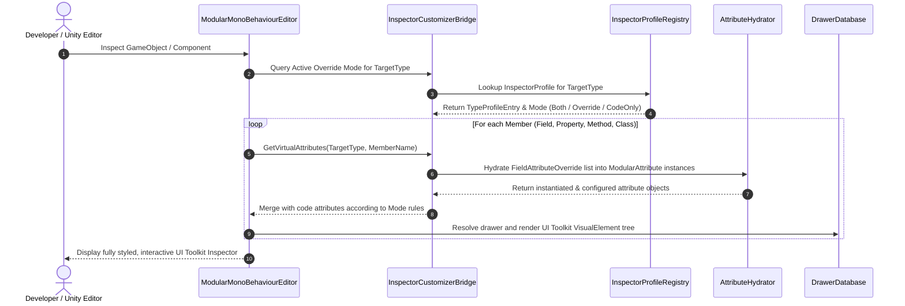

# System Architecture & Technical Foundation

> **Module:** MSUltimate Inspector Customizer — Getting Started  
> **Topic:** Dual-Pipeline Architecture, Virtual Attribute Hydration, and Execution Lifecycle

---

## 1. Dual-Pipeline Design Philosophy

Traditionally in Unity, styling an inspector requires either writing attributes directly into gameplay scripts (`[BoxGroup]`, `[ProgressBar]`, `[ShowIf]`) or authoring custom `Editor` scripts extending `Editor`. While attributes improve ergonomics, they intertwine visual inspector styling with gameplay code. If a designer wants to change a progress bar color, reorganize groups, or hide debug properties, they must edit source code, trigger script compilation, and risk merge conflicts in Git.

**MSUltimate Inspector Customizer** introduces a **dual-pipeline decoupled architecture**:

```
[Developer / Designer Choice]
         │
         ├───► Pipeline A: Virtual Hydration (Default)
         │     • Zero code modification
         │     • Zero domain reloads / script recompilation
         │     • Overrides stored in lightweight ScriptableObject profiles
         │     • Dynamically injected at draw-time via InspectorCustomizerBridge
         │
         └───► Pipeline B: Source Code Baking (On-Demand)
               • Converts virtual overrides into permanent C# attributes
               • Safe AST parsing and injection via AttributeCodeBaker
               • Full diff preview and syntax highlighting
               • Zero external runtime dependencies when exported
```

---

## 2. Core Data Structures

All customization data is represented through three lightweight serializable classes defined in `MaharajaStudio.MSUltimate.InspectorCustomizer`:

### 2.1 `SerializedKVP`
Stores attribute constructor arguments and named properties as string pairs.
```csharp
[Serializable]
public class SerializedKVP
{
    public string Key;   // e.g. "__ctor_min_Single", "SliderColor", "Height"
    public string Value; // e.g. "0.0", "#FF4444", "24"
}
```
- **Constructor Arguments:** Stored with key format `__ctor_<paramName>_<typeName>` (e.g. `__ctor_min_Single`, `__ctor_lines_Int32`).
- **Named Properties:** Stored directly using the property name (`SliderColor`, `ShowPercentage`, `Height`).
- **Hydration Conversion:** Strings are parsed into strongly typed objects (`string`, `bool`, `int`, `float`, `double`, `long`, `Enum` by name or flag integer, `Color`/`Color32` with or without `#`, `Vector2` as `"x,y"`, `Vector3` as `"x,y,z"`, and 1D arrays of any primitive type delimited by `,`, `;`, `|`, `>`, `›`, or `/`) at draw-time by `AttributeHydrator`.

### 2.2 `FieldAttributeOverride`
Represents an applied virtual attribute on a target member:
```csharp
[Serializable]
public class FieldAttributeOverride
{
    public string MemberName;             // Name of target field or method
    public bool IsMethod;                 // True for methods, false for fields
    public bool IsClassLevel;             // True for class/component-level attributes
    public string AttributeTypeName;       // Assembly-qualified type name
    public bool IsDisabled;               // Temporarily muted in inspector
    public bool IsCollapsed;              // Collapsed in the Customizer editor deck
    public List<SerializedKVP> Values;    // Serialized parameters
}
```

### 2.3 `TypeProfileEntry` & `InspectorProfile`
Container ScriptableObject storing overrides organized by component type:
```csharp
[CreateAssetMenu(menuName = "Maharaja Studio/MSUltimate/Inspector Customizer/Inspector Profile")]
public class InspectorProfile : ScriptableObject
{
    public List<TypeProfileEntry> TypeEntries = new List<TypeProfileEntry>();
}
```

---

## 3. Draw-Time Hydration Lifecycle

When a component is selected in the Unity Inspector, `MSUltimate`'s core drawer engine executes the following pipeline:



1. **Bridge Interception:** `ModularMonoBehaviourEditor` checks `InspectorCustomizerBridge.IsCustomizerAvailable`.
2. **Profile Lookup:** `InspectorProfileRegistry` retrieves the active profile for the component type from memory cache (zero disk reads per frame).
3. **Attribute Hydration:** `AttributeHydrator` uses reflection caches to instantiate the attribute class and assign its constructor parameters and property values.
4. **Drawing & Stacking:** Core drawers (`DrawerDatabase`) receive the instantiated attributes exactly as if they were written in C# source code, rendering headers, progress bars, foldouts, and interactive controls seamlessly.

---

## 4. Performance & Memory Profile

- **Zero Runtime Overhead:** All Inspector Customizer classes are editor-only or reside in lightweight editor-bound assemblies. In standalone game builds (Windows, Mac, iOS, Android, Consoles), no customizer code or reflection overhead executes.
- **Aggressive Reflection Caching:** Member queries, attribute constructors, and parameter parsers are cached in static dictionaries upon first access. Inspector repaints operate at native UI Toolkit speed (under 0.2ms per draw call).
- **Non-Allocating Hydration:** Attribute instances created during hydration are pooled and cached until the profile is modified or target selection changes.
