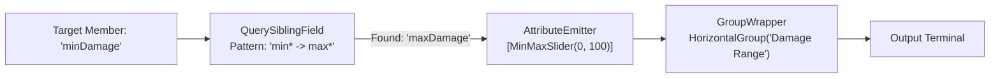

# Relational Sibling Queries & Dynamic Companion Pairing

> **Module:** MSUltimate Inspector Customizer — Makeover Graph  
> **Topic:** Companion Field Detection, Relational Sliders, and Dynamic String Extraction

---

## 1. The Challenge of Relational Fields

In traditional game development, related variables are often declared as independent adjacent fields:
```csharp
public float minDamage = 10f;
public float maxDamage = 50f;

public float currentHealth = 80f;
public float maxHealth = 100f;

public bool enableShield = true;
public float shieldCapacity = 250f;
```
Standard Unity renders these as flat, disconnected text input boxes. Manually wiring `[MinMaxSlider]`, `[ProgressBar]`, and `[ShowIf]` requires repetitive attribute coding.

The Makeover Graph solves this automatically using **Relational Sibling Queries**.

---

## 2. Using `QuerySiblingField`

The `QuerySiblingField` node inspects the member's parent class to locate companion fields based on naming conventions and stem matching:



### Supported Stem Matching Modes
1. **`MinMax Pair`:** Matches `min*` with `max*` (e.g. `minSpeed` $\rightarrow$ `maxSpeed`).
2. **`StartEnd Pair`:** Matches `start*` with `end*` (e.g. `startTime` $\rightarrow$ `endTime`).
3. **`Dimension Pair`:** Matches `width`/`height` or `innerRadius`/`outerRadius`.
4. **`CurrentMax Pair`:** Matches `current*` with `max*` (e.g. `currentMana` $\rightarrow$ `maxMana`).

---

## 3. Dynamic Progress Bar Ceiling Binding

When styling a stat bar like `currentHealth`, hardcoding `Max = 100` breaks when player stats scale up at runtime.

Using `QuerySiblingField` paired with `AttributeEmitter`:
1. `ConditionName` matches `*health*`.
2. `QuerySiblingField` searches for `maxHealth` on the same component.
3. If found, the node dynamically injects the companion field name into the `ProgressBarAttribute.MaxMember` parameter!
4. **Result:** In the Inspector, the progress bar's maximum value dynamically tracks whatever value is currently in `maxHealth`!

---

## 4. Name Parsing with `RegexExtractor`

The `RegexExtractor` node enables automatic categorization and labeling by dissecting variable name anatomy:

### Example: Auto-Generating Tabs from Prefixes
Given a class with fields:
- `Combat_AttackPower`
- `Combat_CritChance`
- `Movement_WalkSpeed`
- `Movement_SprintMultiplier`

Configure `RegexExtractor`:
- **Pattern:** `^(?<category>[^_]+)_(?<label>.+)$`
- **Capture Groups:**
  - `category`: `"Combat"`, `"Movement"`
  - `label`: `"AttackPower"`, `"WalkSpeed"`
- Wire `category` into `GroupWrapper` (`BeginTabGroup`).
- Wire `label` into `AttributeEmitter[LabelStyle]`.
- **Result:** The graph automatically organizes 40+ raw variables into organized, clean **Tab Groups** named after their prefixes, stripping messy underscores from variable names!
