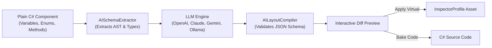

# AI Decorator Overview & Generation Workflow

> **Module:** MSUltimate Inspector Customizer — AI Decorator  
> **Topic:** AI-Assisted Inspector Design, Multi-LLM Generation, and Live Diff Application

---

## 1. What is the AI Decorator?

The **AI Decorator** (`AIDecoratorModalWindow`) is an intelligent assistant built directly into the Unity Editor. It transforms plain C# components into beautifully styled, ergonomic UI Toolkit inspectors using Large Language Models (LLMs).

Rather than manually deciding which progress bars, foldouts, sliders, or colors to assign to 40+ gameplay variables, you click **AI Decorator**, select an aesthetic style (e.g. *RPG Combat HUD*, *Sci-Fi Weapon System*, *Clean Minimalist*), and let the AI generate an optimal inspector layout in seconds.



---

## 2. Opening the AI Decorator

You can invoke the AI Decorator modal from multiple locations:
1. **From Customizer Window:** Click the purple **`⚡ AI Decorator`** button in the top toolbar.
2. **From Component Context Menu:** Right-click any Component header $\rightarrow$ `MSUltimate > 🎨 Open Inspector Makeover Wizard...` $\rightarrow$ select the **AI Assistant** tab.
3. **From Member Action:** Select any individual member in `InspectorCustomizerWindow` and click the AI icon next to it to generate suggestions focused strictly on that member.

---

## 3. The 3-Step Generation Workflow

```
┌────────────────────────────────────────────────────────────────────────┐
│  AI Decorator Modal: HeroController [Assembly-CSharp]                  │
│  Profile: [ MSUltimate_AIProfile.asset ]                               │
│  Provider: [ Anthropic ▼ ]   Model: [ claude-3-5-sonnet-20241022 ▼ ]   │
│  Preset:   [ Modern Tabs & Controls ▼ ]                                │
├────────────────────────────────────────────────────────────────────────┤
│  [ Tab 1: Layout Generator ]         [ Tab 2: Raw Payload & Schema ]   │
│  ────────────────────────────────────────────────────────────────────  │
│  Positive Prompt:                                                      │
│  "Style health and mana with animated bars. Place abilities into tabs."│
│  Negative Prompt:                                                      │
│  "Do not use more than 3 tabs. Avoid pure red buttons."                │
│                                                                        │
│  Few-Shot Reference Examples:                                          │
│  [ + Add Script Example ]            [ + Add Mockup Image ]            │
│                                                                        │
│  ▼ Advanced Parameter Overrides                                        │
│    System Prompt Mode: [ StudioDefault ▼ ]   Temperature: [ 0.2 ]      │
│    Max Tokens: [ 4096 ]                      [✓] Thinking Model        │
│    [✓] Clear Existing Overrides on Apply                               │
├────────────────────────────────────────────────────────────────────────┤
│  Status: ✅ Success! Applied 8 attribute overrides.                    │
│  [ Cancel ]          [ ⚙️ Settings ]          [ ⚡ Generate Layout ]     │
└────────────────────────────────────────────────────────────────────────┘
```

### Step 1: Configure Provider, Model & Preset Directives
- Choose your preferred AI service (`OpenAI`, `Anthropic`, `Gemini`, `Groq`, `Mistral`, `Ollama`, `OpenRouter`, or `Custom`).
- Pick an aesthetic preset (e.g. *Modern Tabs & Controls*, *Clean Foldouts*, *Compact Pro*, *Validation & Safety*, *Minimalist*, *Full Studio Suite*).
- Enter custom natural-language instructions in the **Positive Prompt** and **Negative Prompt** fields (e.g. *"Use orange and dark charcoal theme, group weapon stats into a split-pane, and hide debug toggles when IsAlive is false"*).
- Attach reference C# scripts or UI mockup images for few-shot guidance.

### Step 2: Generate & Instant Virtual Hydration
- Click **⚡ Generate Layout**.
- The AI client contacts your provider, parses the JSON response via `AILayoutResponse`, and validates attribute types against MSUltimate assemblies.
- `AILayoutCompiler.CompileAndApply()` immediately injects the validated attributes into your component's active `InspectorProfile` asset.
- The Unity Inspector window repaints in real-time, giving you an immediate live interactive preview without touching C# code!

### Step 3: Visual Tuning & Optional Permanent Code Baking
- Inspect the generated attribute cards in `InspectorCustomizerWindow`. Tweak colors, reorder stacks, or mute individual cards as desired.
- When satisfied, click the **Bake Code** toolbar button (`_bakeBtn`) to permanently inject the layout into your C# script source code with syntax-highlighted diff review.
