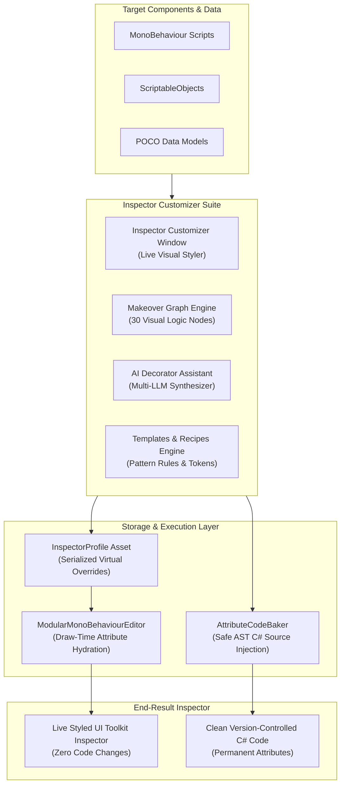

# MSUltimate - Inspector Customizer Documentation

> **Visual UI Toolkit Templating, Non-Destructive Inspector Styling, Makeover Node Graphs, and AI-Powered Layout Suite.**  
> Official Addon for Maharaja Studio Ultimate Inspector Suite (`MSUltimate`). Compatible with Unity 6 (6000.x)+.

---

## 1. System Overview

**MSUltimate Inspector Customizer** is a dual-pipeline visual styling and layout engine designed to transform flat, unstyled Unity Inspectors into production-grade UI Toolkit workspaces—**without requiring changes to underlying C# scripts**.

Traditional Unity inspector customization requires developers to manually decorate fields with dozens of attributes in code or author complex custom `Editor` scripts. Inspector Customizer decouples visual presentation from game logic:

1. **Virtual Runtime Hydration Layer:** Visually apply, reorder, group, and tune MSUltimate attributes inside a visual editor window. Overrides are serialized into lightweight ScriptableObject profiles (`InspectorProfile`) and dynamically injected into Unity's inspector pipeline at draw-time via `ModularMonoBehaviourEditor`.
2. **Deterministic Source Code Baker:** When you are ready to commit your inspector layout directly to your codebase, 1-Click Code Baking safely injects attributes into your C# script source with syntax-highlighted diff review and namespace resolution.
3. **Makeover Graph Pipeline:** A 30-node visual logic canvas built on UI Toolkit GraphView. Define pattern-matching rules, companion field pairings (e.g. `min*`/`max*` sliders), dynamic progress bar bindings, and layout wrappers.
4. **Multi-LLM AI Decorator:** Intelligent inspector generation powered by OpenAI, Claude, Gemini, Ollama, Groq, Mistral, and custom endpoints. Features Studio Privacy Shield (local key encryption and code scrubbing) to protect proprietary game logic.

---

## 2. Documentation Architecture & Directory

| Section | Manual Title | Description | Index Link |
| :--- | :--- | :--- | :--- |
| **01** | **Getting Started** | System architecture, 60-second quick start, and the 3 override modes (`Both`, `EditorOverride`, `CodeOnly`). | [Open Getting Started](01-getting-started/overview-and-architecture.md) |
| **02** | **Inspector Customizer Window** | Visual editor window tour, AttributePicker, parameter cards, member scoping, and batch multi-member editing. | [Open Window Manual](02-inspector-customizer-window/window-tour-and-layout.md) |
| **03** | **Makeover Graph** | Visual node graph canvas, 30-node reference directory, relational sibling queries, macros, and diagnostics. | [Open Makeover Graph](03-makeover-graph/makeover-graph-overview.md) |
| **04** | **AI Decorator** | Multi-LLM assistant, Studio Privacy Shield, prompt directives, few-shot examples, and schema compilation. | [Open AI Decorator](04-ai-decorator/ai-decorator-overview.md) |
| **05** | **Templates & Recipes** | Declarative rule templates, attribute recipes with dynamic string tokens, and intelligent makeover passes. | [Open Templates & Recipes](05-templates-and-recipes/template-recipe-manager.md) |
| **06** | **Code Baking** | AST-driven source code injection, BakeCodePreviewWindow, diff review, and safety reconciliation. | [Open Code Baking](06-code-baking/code-baking-workflow.md) |
| **07** | **Component Defaults & Rules** | Project-wide automatic styling, master safety guards, and granular multi-condition ignore rules. | [Open Component Defaults](07-component-defaults-and-rules/global-defaults-manager.md) |
| **08** | **Workflows & Menus** | 1-Click Magic Makeovers, Makeover Wizard, Live Before-vs-After comparison window, and context menus. | [Open Workflows Manual](08-workflows-and-context-menus/magic-makeover-and-wizard.md) |
| **09** | **Preferences & Settings** | 8-category split-view settings window, API key security, catalog exploration, and favorites manager. | [Open Settings Manual](09-preferences-and-settings/settings-window-overview.md) |

---

## 3. Core Feature Comparison Matrix

| Capability | Standard Unity | Odin / Tri-Inspector | MSUltimate Inspector Customizer |
| :--- | :---: | :---: | :---: |
| **Style Without Editing C#** | ❌ None | ❌ Code attributes only | ✅ **100% Non-destructive virtual hydration** |
| **Visual Node Graph Pipeline**| ❌ None | ❌ None | ✅ **30-node UI Toolkit Makeover Graph** |
| **1-Click AI Inspector Design**| ❌ None | ❌ None | ✅ **Integrated Multi-LLM with Privacy Shield** |
| **Permanent Code Baking** | ❌ Manual typing | ❌ Manual typing | ✅ **1-Click AST C# injection with diff preview** |
| **Side-by-Side Live Compare** | ❌ None | ❌ None | ✅ **Interactive Before vs. After diff window** |
| **Batch Multi-Member Styling** | ❌ One-by-one | ❌ One-by-one | ✅ **Batch attribute modal with conflict handling** |
| **Project-Wide Default Themes** | ❌ None | ❌ Limited | ✅ **Global defaults with granular ignore filters** |
| **Subgraphs & Macros** | ❌ None | ❌ None | ✅ **Shareable `.msmakomacro` assets** |

---

## 4. Quick Access Shortcuts & Menu Paths

| Tool / Surface | Unity Editor Menu Path | Context Menu Shortcut |
| :--- | :--- | :--- |
| **Inspector Customizer** | `Tools > Maharaja Studio > MSUltimate > Inspector Customizer > Inspector Customizer` | Right-click Component $\rightarrow$ `MSUltimate > 🎨 Open Inspector Makeover Wizard...` |
| **Makeover Graph** | `Tools > Maharaja Studio > MSUltimate > Inspector Customizer > Makeover Graph Editor` | Double-click any `.asset` of type `InspectorTemplate` or `MakeoverMacroAsset` |
| **1-Click Magic Makeover** | — | Right-click Component $\rightarrow$ `MSUltimate > ⚡ Magic Makeover (1-Click Auto-Detect)` |
| **Live Before/After Compare** | — | Right-click Component $\rightarrow$ `MSUltimate > 🪟 Live Compare (Before vs After)...` |
| **Apply Curated Preset** | — | Right-click Component $\rightarrow$ `MSUltimate > 📋 Apply Preset >` (12 Sub-Presets) |
| **Template & Recipe Manager** | `Tools > Maharaja Studio > MSUltimate > Inspector Customizer > Template & Recipe Manager` | — |
| **Component Defaults & Rules**| `Tools > Maharaja Studio > MSUltimate > Inspector Customizer > Component Defaults & Rules` | — |
| **Customizer Settings** | `Tools > Maharaja Studio > MSUltimate > Inspector Customizer > Inspector Customizer Settings` | — |
| **Rebuild Built-in Presets** | `Tools > Maharaja Studio > MSUltimate > Rebuild Built-in Presets & Recipes` | — |
| **Customize Window** | — | Right-click `EditorWindow` tab $\rightarrow$ `MSUltimate > Customize Window...` |
| **Customize Asset / Script** | `Assets > Maharaja Studio > MSUltimate > Customize Inspector...` | Right-click MonoScript header $\rightarrow$ `MSUltimate > Customize Inspector...` |
| **Customize GameObject** | `GameObject > Maharaja Studio > MSUltimate > Customize Inspector...` | — |
| **Clear Overrides** | — | Right-click Component $\rightarrow$ `MSUltimate > 🗑️ Clear Customizer Overrides` |
