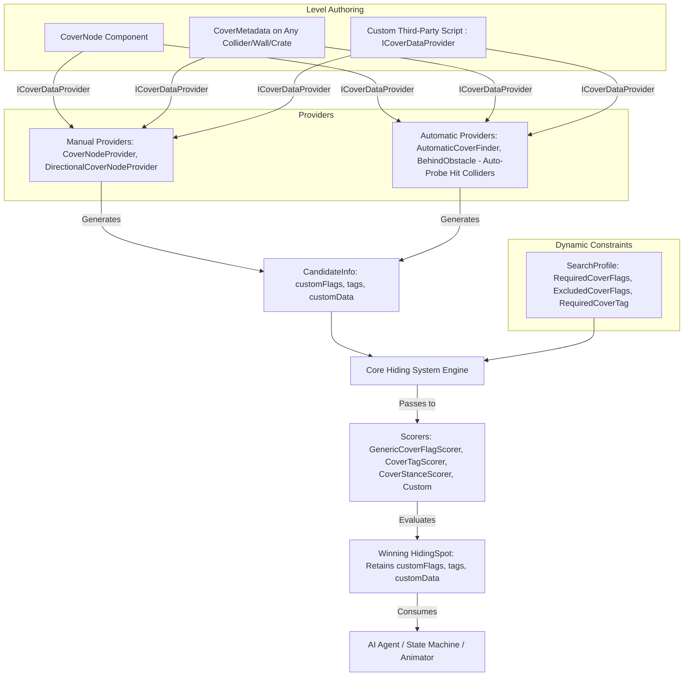

# Custom Cover Metadata & Stance/Edge Point Guide

Tactical AI features a **universal, generic metadata pipeline** that allows you to attach, discover, evaluate, and consume tactical attributes on cover points across your entire project.

Whether you want to specify **Stances (Low/Crouch vs. High/Standing)**, mark **Corners/Edges**, tag obstacles as **Destructible/Vaultable**, assign **Gameplay Tags** (`"SniperNest"`, `"Reinforced"`), or implement custom third-party cover data, this guide covers the entire architecture.

---

## Architecture at a Glance



---

## 1. The Core Data Structures

### `CoverPointFlags` (Standard Bitmask)
```csharp
[Flags]
public enum CoverPointFlags
{
    None = 0,
    LowStance = 1 << 0,     // Crouch / half-height cover
    HighStance = 1 << 1,    // Standing / full-height cover
    EdgePoint = 1 << 2,     // Corner or edge of an obstacle (ideal for peeking)
    Vaultable = 1 << 3,     // Obstacle can be vaulted/mantled
    Destructible = 1 << 4   // Obstacle can be penetrated or destroyed
}
```

### `CandidateInfo` & `HidingSpot`
Both carry:
* `int customFlags`: Bitmask combining standard flags (`CoverPointFlags`) and custom user bits.
* `IReadOnlyList<string> tags`: Optional string tags for classification.
* `object customData`: Reference payload (e.g. source `CoverNode`, `CoverMetadata`, or custom class).

**Built-in Helper Methods**:
```csharp
candidate.HasFlag(CoverPointFlags.LowStance);
candidate.HasFlag(myCustomBitmask);
candidate.HasTag("SniperNest");
var mySource = candidate.GetData<CoverMetadata>();
```

---

## 2. Universal Contract: `ICoverDataProvider`

Any component on a GameObject can provide metadata to the system by implementing `ICoverDataProvider`:

```csharp
public interface ICoverDataProvider
{
    int CoverFlags { get; }
    IReadOnlyList<string> Tags { get; }
    object CustomData { get; }
}
```

Both `CoverNode` and `CoverMetadata` implement this interface out-of-the-box. If your studio has existing cover classes from other assets or frameworks, simply implement this interface to connect them seamlessly to Tactical AI!

---

## 3. Level Authoring

### Option A: `CoverMetadata` Component (Drop-in for Any Prefab or Collider)
Attach `CoverMetadata` directly to any wall, obstacle, crate, vehicle, or sandbag in your scene:
* **Stance**: `Low`, `High`, or `Both`.
* **Edge Point**: Flag if placed on a corner.
* **Vaultable & Destructible**: Toggles for physical cover properties.
* **Custom Flags**: Extra integer bitmask for project-specific flags.
* **Tags**: Add string tags like `"Wood"`, `"Concrete"`, `"SniperNest"`, `"Bunker"`.

### Option B: `CoverNode` (Hand-Placed Nodes)
`CoverNode` now features:
* Built-in stance selection and edge point toggle.
* Scene view gizmos:
  * **Amber wire box**: Crouch / Low cover (~0.9m).
  * **Cyan wire box**: Standing / High cover (~1.8m).
  * **Green wire box**: Versatile / Both stances (~1.4m).
  * **Magenta wire sphere**: Corner/Edge indicator.
  * **Cyan arrow**: Cover facing angle.

---

## 4. Automatic Providers Probe Level Geometry

You do **not** need to manually place cover nodes to use metadata!

When `AutomaticCoverProviderSO` (Automatic Cover Finder) or `BehindObstacleProviderSO` (Behind Obstacle) casts rays against the environment, it automatically checks if the hit obstacle collider (or its parent) has an `ICoverDataProvider` (such as `CoverMetadata`).

If found, the procedural candidates automatically inherit the obstacle's flags, tags, and custom data!

---

## 5. Built-In Scorers (No C# Required!)

### `GenericCoverFlagScorerSO`
* **Menu**: `TacticalAI > Scorers > Defensive > Generic Cover Flag Scorer`
* Configure any combination of standard or custom bit flags in the Inspector.
* **Match Rules**:
  * `RequireAll`: Candidate must have all target flags.
  * `RequireAny`: Candidate must have at least one target flag.
  * `ExcludeAll`: Candidate must not have any target flag.
  * `ScoreWeighted`: Awards a score proportional to the percentage of matching flags.
* Supports soft score weighting (`matchScore` / `mismatchScore`) or hard disqualification (`vetoOnMismatch = true`).

### `CoverTagScorerSO`
* **Menu**: `TacticalAI > Scorers > Defensive > Cover Tag Scorer`
* Evaluate string tags (e.g. `"SniperNest"`, `"Hazard"`).
* **Rules**: `PreferTag`, `AvoidTag`, `RequireTag`, `ExcludeTag`.

### Preset Scorers
* **`CoverStanceScorerSO`**: Dedicated scorer for low vs. high posture preference.
* **`CoverEdgeScorerSO`**: Dedicated scorer for edge/corner peeking preference.

---

## 6. Dynamic Run-time Constraints via `SearchProfile`

AI agents can dynamically filter cover points on the fly using `SearchProfile`:

```csharp
SearchProfile profile = new SearchProfile();

// Demand only low/crouch cover:
profile.RequiredCoverFlags = (int)CoverPointFlags.LowStance;

// Forbid destructible cover when under heavy fire:
profile.ExcludedCoverFlags = (int)CoverPointFlags.Destructible;

// Demand cover in a designated sniper zone:
profile.RequiredCoverTag = "SniperNest";

// Trigger search with dynamic profile:
agent.RetreatToHide(profile);
```
Candidates that do not satisfy these constraints are culled immediately in the core search loop before scoring runs, saving CPU time!

---

## 7. Consuming Metadata in AI Controllers

When the search completes, the chosen `HidingSpot` retains all metadata:

```csharp
HidingSpot spot = agent.CurrentHidingSpot;

if (spot.IsValid)
{
    // 1. Control character animation:
    if (spot.HasFlag(CoverPointFlags.LowStance))
    {
        animator.SetBool("IsCrouching", true);
    }
    else
    {
        animator.SetBool("IsCrouching", false);
    }

    // 2. Check for corner peeking capability:
    if (spot.HasFlag(CoverPointFlags.EdgePoint))
    {
        // Ready weapon around the corner
    }

    // 3. Check custom tags:
    if (spot.HasTag("SniperNest"))
    {
        EquipSniperRifle();
    }

    // 4. Access source object:
    CoverMetadata meta = spot.GetData<CoverMetadata>();
    if (meta != null && meta.isDestructible)
    {
        // Monitor cover integrity
    }
}
```
